# Wiktor Wojtarowicz

<picture>
  <source media="(prefers-color-scheme: dark)" srcset="docs/portfolio-map-dark.svg">
  
</picture>

## Applied AI portfolio

Each repository solves one problem that shows up when an agent or a RAG system meets real input. Each runs locally from its README, states its limits, and opens with a diagram of how it works plus a full system map.

### Control: what an agent may do

| Repository | What it shows |
|---|---|
| [agent-boundary-lab](https://github.com/WWIntegrations/agent-boundary-lab) | `allow`, `deny` or `require_approval` for a proposed tool call, from identity and policy the agent cannot change |
| [durable-approval-workflows](https://github.com/WWIntegrations/durable-approval-workflows) | an approved effect is applied once even if the process dies between saving and answering |
| [agent-audit-ledger](https://github.com/WWIntegrations/agent-audit-ledger) | hash-chained audit trail; verification against a checkpoint an independent observer kept |
| [mcp-contract-auditor](https://github.com/WWIntegrations/mcp-contract-auditor) | which MCP tool contracts changed between two versions and which changes break callers |
| [injection-defense-benchmark](https://github.com/WWIntegrations/injection-defense-benchmark) | whether document text becomes a control record when an application builds its context |
| [guard-generalization-study](https://github.com/WWIntegrations/guard-generalization-study) | how often a frozen prompt-injection classifier flags harmless prompts |

### Retrieval and evidence: what the model may read and cite

| Repository | What it shows |
|---|---|
| [tenant-aware-retrieval](https://github.com/WWIntegrations/tenant-aware-retrieval) | ACL filter before ranking, so a revoked permission applies on the next search |
| [rag-citation-validator](https://github.com/WWIntegrations/rag-citation-validator) | every cited document ID was in the context actually sent to the model |
| [document-ingestion-pipeline](https://github.com/WWIntegrations/document-ingestion-pipeline) | PDF and text into versioned chunks; a new revision retires the old one, bad input is quarantined |
| [knowledge-freshness-monitor](https://github.com/WWIntegrations/knowledge-freshness-monitor) | which answers go back to a human after a source changes, expires or disappears |
| [evidence-research-agent](https://github.com/WWIntegrations/evidence-research-agent) | public pages as immutable versions; every quote proven character for character |
| [retrieval-eval-workbench](https://github.com/WWIntegrations/retrieval-eval-workbench) | BM25 against Jaccard on graded judgments, with the queries each one misses |

### Evaluation and realtime

| Repository | What it shows |
|---|---|
| [agent-eval-release-gate](https://github.com/WWIntegrations/agent-eval-release-gate) | PASS, BLOCKED or INVALID for a candidate agent before it ships |
| [tool-routing-eval](https://github.com/WWIntegrations/tool-routing-eval) | case by case, which routing decisions a tool-catalog change made better or worse |
| [realtime-voice-handoff](https://github.com/WWIntegrations/realtime-voice-handoff) | audio cut-off and state handoff over WebRTC, proven by a matching acknowledgement |

### Tools

| Repository | What it shows |
|---|---|
| [ww-scraper](https://github.com/WWIntegrations/ww-scraper) | local scraping toolkit: eleven actors, RFC 9309 robots.txt, JavaScript rendering behind an SSRF-filtering proxy, no evasion |
| [agents-bridge](https://github.com/WWIntegrations/agents-bridge) | one hardened coding-agent setup shared by Claude Code, Codex, Gemini CLI, OpenCode, Qwen Code and Goose |

---

CEO of OTW. Robimy strony i narzędzia dla małych firm.

Programista: agenci AI z narzędziami, systemy webowe na Next.js, FastAPI i Supabase,
strony i sklepy. Do tego testy, bramki jakości i zabezpieczenia (red team LLM,
RLS, CSP), żeby to działało na produkcji.

Portfolio z realizacjami i umiejętnościami: [wiktorwojtarowicz.pl](https://wiktorwojtarowicz.pl)
(profil tekstowy: [wiktorwojtarowicz.pl/o-mnie](https://wiktorwojtarowicz.pl/o-mnie/)).

Wśród publicznych repozytoriów są dwa małe programy, które powstały przy realnej robocie i okazały się
przydatne poza nią. Każdy robi jedną rzecz, każdy działa zaraz po sklonowaniu
i żaden niczego nie wymaga do zainstalowania. Oba na licencji MIT, więc można
je wziąć i przerobić pod siebie.

- [generator-og](https://github.com/WWIntegrations/generator-og) - obrazki
  og:image 1200 na 630 z tytułu i nazwy firmy; tryb hurtowy robi komplet
  z jednego pliku JSON.
- [spis-plikow](https://github.com/WWIntegrations/spis-plikow) - jeden czytelny
  spis katalogu w markdownie, z polską kolejnością i szukaniem bez ogonków.

Nazwy poleceń i pól są po polsku, bo pisaliśmy je dla polskich firm. Każde
repozytorium ma też `README.en.md`, który tłumaczy je jednym zdaniem.

Strona: [otw-dev.com](https://www.otw-dev.com)

---

## English

Developer: AI agents with tool calling, web systems on Next.js, FastAPI and Supabase,
websites and shops, with tests, quality gates and security work behind them.
Portfolio: [wiktorwojtarowicz.pl](https://wiktorwojtarowicz.pl).

Among the public repositories are two small tools, built during real work and useful outside it. Each does one
thing, each runs straight after cloning, none needs anything installed. Both MIT.

- [generator-og](https://github.com/WWIntegrations/generator-og) - og:image
  generator, 1200 by 630, batch mode from one JSON file.
- [spis-plikow](https://github.com/WWIntegrations/spis-plikow) - one readable
  markdown index of a directory, Polish collation, search that ignores
  diacritics.

Command names and fields are Polish, because these were written for Polish
businesses. Every repository carries a `README.en.md` explaining them.

---

Autor: Wiktor Wojtarowicz. Zbudowane w OTW, [otw-dev.com](https://www.otw-dev.com).
